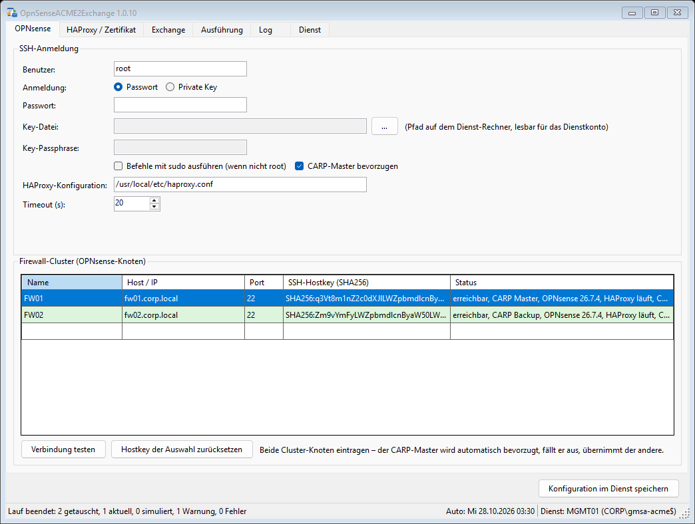
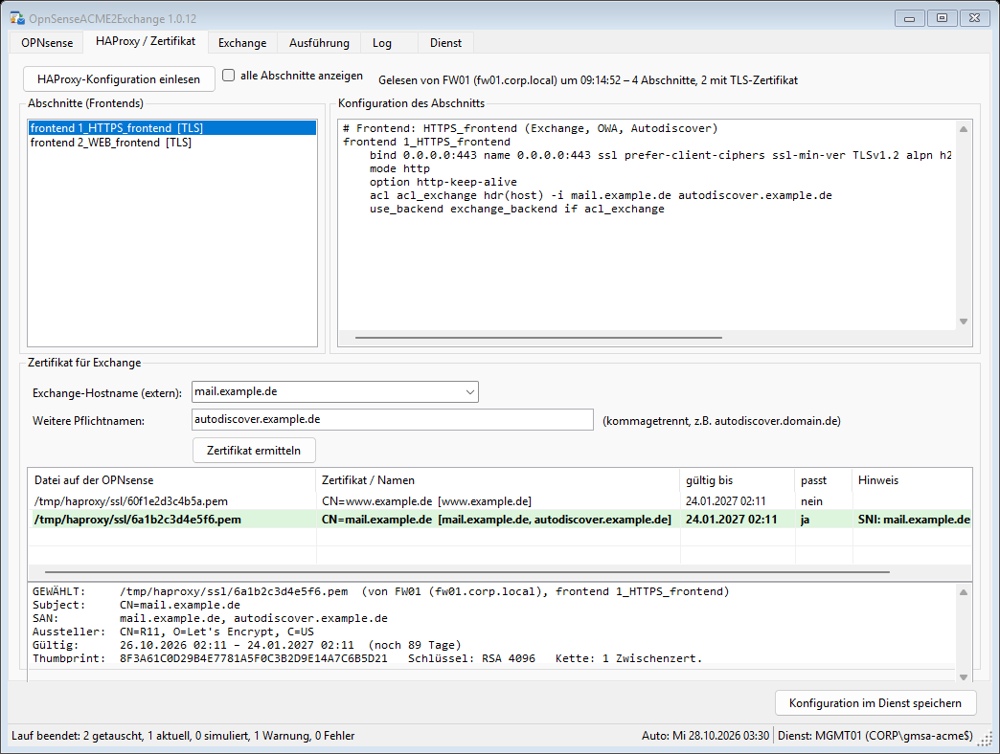
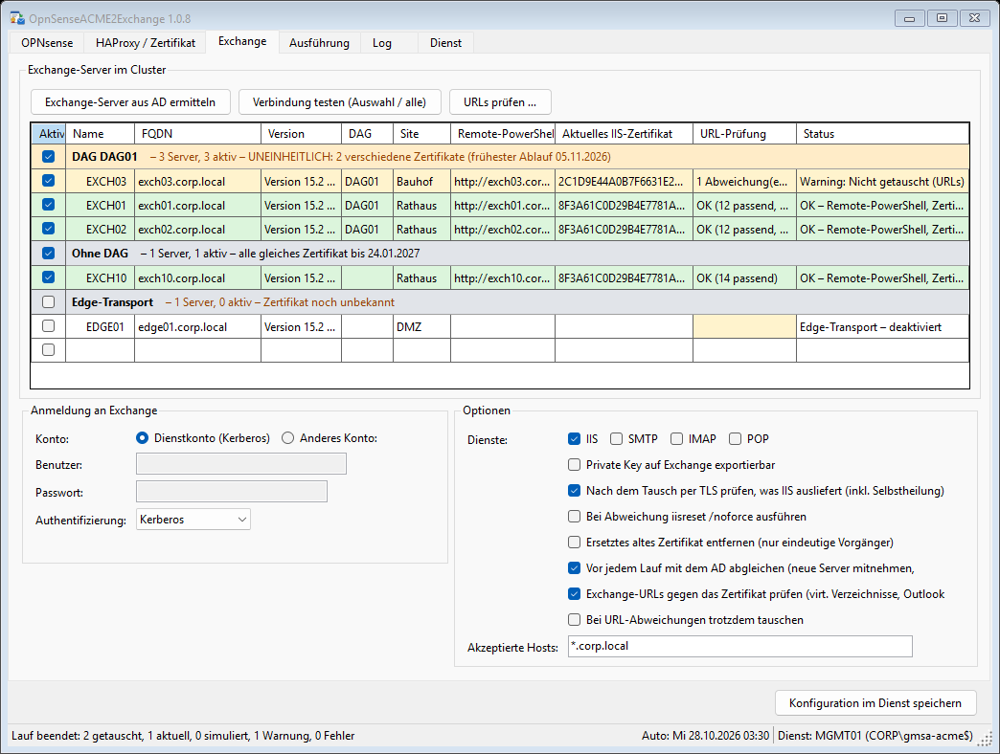
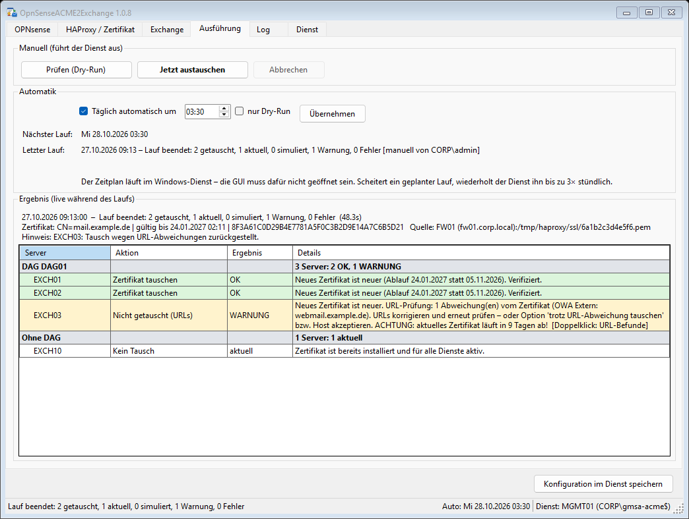
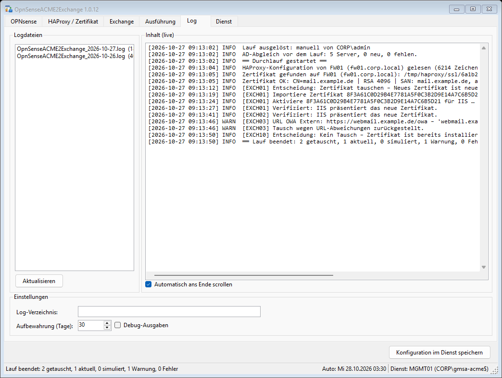
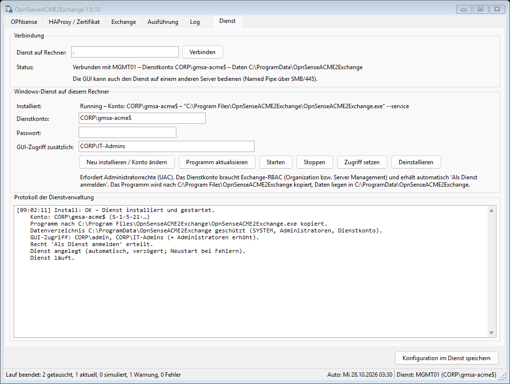
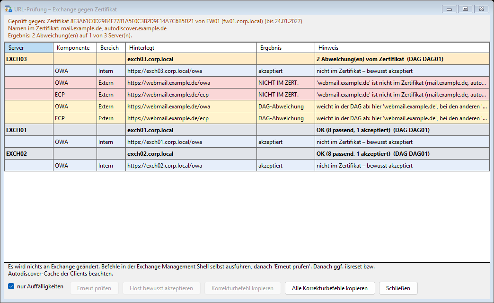

# OpnSenseACME2Exchange

Holt das ACME-Zertifikat aus dem **HAProxy der OPNsense** und verteilt es auf **alle Exchange-Server**. HAProxy und Exchange haben damit immer **dasselbe** Zertifikat, was Extended Protection bei TLS-Bridging voraussetzt.

Die Lösung besteht aus **einer EXE in zwei Rollen**:

- **Windows-Dienst**: Er erledigt alle Arbeit unter einem Dienstkonto (Domänenkonto oder gMSA): SSH zur OPNsense, AD-Abfrage, Exchange-Remote-PowerShell, Tests, Läufe und den täglichen Zeitplan. Er hält Konfiguration und Geheimnisse.
- **GUI**: reine Bedienoberfläche. Sie schickt Einstellungen und Befehle über eine Named Pipe an den Dienst und zeigt Status, Ergebnisse und Logs live an. Admins an der GUI brauchen **keine** Exchange-Rechte.

```
 Admin-PC / Server                         Server (Dienst, Konto z.B. CORP\gmsa-acme$)
┌──────────────────┐  Named Pipe (ACL)   ┌──────────────────────────────────────────────┐
│ GUI              │ ──────────────────► │ OpnSenseACME2Exchange-Dienst                 │
│ (Befehle, Status,│ ◄────────────────── │  ├─ SSH ──► OPNsense-Cluster (CARP-Failover) │
│  Logs live)      │                     │  ├─ LDAP ─► AD (Exchange-Server ermitteln)   │
└──────────────────┘                     │  └─ PS ───► Exchange (Import/Enable/Prüfen)  │
                                         └──────────────────────────────────────────────┘
```

## Screenshots

Die Bilder erzeugt die CI bei jedem Build automatisch mit Demodaten (`OpnSenseACME2Exchange.exe --screenshots <ordner>`).

| | |
|---|---|
| **OPNsense-Cluster**  | **HAProxy / Zertifikat**  |
| **Exchange, nach DAG gruppiert**  | **Ausführung**  |
| **Log (live vom Dienst)**  | **Dienstverwaltung**  |
| **URL-Prüfung**  | |

## Installation

1. EXE starten und den Reiter **Dienst** öffnen.
2. Ein Dienstkonto angeben, z.B. `CORP\gmsa-acme$` (Passwort leer lassen) oder `CORP\svc-acme` mit Passwort. Optional eine AD-Gruppe für den GUI-Zugriff eintragen (z.B. `CORP\IT-Admins`).
3. **Installieren** klicken und die UAC-Abfrage bestätigen. Der Installer erledigt Folgendes:
   - kopiert die EXE nach `C:\Program Files\OpnSenseACME2Exchange\`
   - legt den Dienst an: automatischer, verzögerter Start; Neustart nach 1/1/5 Minuten bei Fehlern
   - erteilt dem Konto das Recht **„Als Dienst anmelden“**
   - schützt `C:\ProgramData\OpnSenseACME2Exchange` (nur SYSTEM, Administratoren und das Dienstkonto)
   - übernimmt eine vorhandene Konfiguration von Version 1.0.x
   - erlaubt dem installierenden Benutzer und den angegebenen Gruppen den GUI-Zugriff
4. Die GUI verbindet sich danach automatisch.

Mit **Programm aktualisieren** wird eine neuere EXE übernommen (Stoppen, Kopieren, Starten). **Zugriff setzen** ändert, wer die GUI benutzen darf.

### Dienstkonto

- Exchange-RBAC: *Organization Management* oder *Server Management*.
- Leserechte im AD (Standard für Domänenkonten).
- Bei **gMSA** muss der Server das Passwort abrufen dürfen: `Set-ADServiceAccount <gmsa> -PrincipalsAllowedToRetrieveManagedPassword <Server>$`.
- Für die optionale Funktion „iisreset bei Abweichung“ zusätzlich lokale Adminrechte auf den Exchange-Servern (WinRM 5985).

### GUI auf einem anderen Rechner

Unter **Dienst → Verbindung** den Servernamen eintragen. Die Pipe läuft über SMB (Port 445) und Kerberos. Der Benutzer muss freigegeben sein, entweder als Installierender oder über **Zugriff setzen**.

## Ersteinrichtung

1. **OPNsense**: Beide Cluster-Knoten eintragen, SSH-Anmeldung setzen und **Verbindung testen**. Der Dienst meldet unbekannte SSH-Hostkeys an die GUI, die sie zur Bestätigung anzeigt. Danach sind die Keys fest hinterlegt. Ohne Bestätigung durch einen Menschen verbindet sich der Dienst nie.
2. **HAProxy / Zertifikat**: **Einlesen**, das Frontend wählen, den externen Hostnamen (z.B. `mail.domain.de`) und weitere Pflichtnamen (z.B. `autodiscover.domain.de`) angeben, dann **Zertifikat ermitteln**.
3. **Exchange**: **Server aus AD ermitteln**. Die Liste ist **nach DAG gruppiert**: zuerst die DAGs, dann Server ohne DAG, dann Edge. Jede Gruppe hat eine Kopfzeile mit Serverzahl, aktiven Servern und Zertifikatsstand; ist der Stand uneinheitlich, wird die Kopfzeile orange. Der Haken in der Kopfzeile wählt die ganze DAG an oder ab. Danach **Verbindung testen**; eine markierte Kopfzeile testet die ganze Gruppe. Getestet werden DNS, Ping, Ports, Remote-PowerShell, der Zertifikatsspeicher und das, was IIS tatsächlich ausliefert. Alles läuft als Dienstkonto.
4. **Ausführung**: Erst **Dry-Run**, dann **Jetzt austauschen**. Danach die **Automatik** einschalten (tägliche Uhrzeit) und **Übernehmen** klicken.

Jede Aktion speichert die aktuelle Konfiguration vorher im Dienst. Passwörter gehen einmal an den Dienst und kommen nie zurück; in der GUI steht dann „gespeichert“.

## Ablauf eines Laufs

1. Alle OPNsense-Knoten werden angefragt, der CARP-Master kommt zuerst. Fällt einer aus, wird das gemeldet und der andere verwendet.
2. `haproxy.conf` des gewählten Frontends wird ausgewertet: `crt`, `crt-list` (inkl. SNI-Filter), ACL-/Map-Dateien.
3. Gewählt wird das Zertifikat mit Private Key, das alle Pflichtnamen abdeckt und am längsten gültig ist.
4. Prüfung: Gültigkeit, Namen und Key. Hinweise gibt es bei ECDSA, fehlender Kette und baldigem Ablauf.
5. Das PFX entsteht nur im Arbeitsspeicher, mit Einmal-Passwort.
6. **URL-Prüfung** (Standard an): Gelesen werden die internen und externen URLs von OWA, ECP, EWS, OAB, ActiveSync und MAPI, die Hostnamen von Outlook Anywhere und die Autodiscover-URI (SCP). Jeder Host wird gegen die SANs geprüft. Passt etwas nicht, wird auf **diesem** Server **nicht getauscht**; im Ergebnis steht eine Warnung, und läuft das aktive Zertifikat bald ab, wird darauf hingewiesen. Das Tool ändert keine URLs. Unter **Exchange → URLs prüfen …** gibt es Korrekturbefehle zum Kopieren, **Erneut prüfen** und **Host bewusst akzeptieren** (z.B. `*.corp.local`). Mit der Option **„Bei URL-Abweichungen trotzdem tauschen“** wird für bewusst so gebaute Umgebungen dennoch getauscht. Zusätzlich wird gemeldet, wenn Server derselben DAG unterschiedliche externe Namen verwenden.
7. Ist „Vor jedem Lauf mit dem AD abgleichen“ an (Standard), wird die Serverliste aktualisiert: Neue Server werden übernommen und aktiviert (Edge nicht), nicht mehr vorhandene übersprungen und gemeldet. Ist das AD nicht erreichbar, läuft der Lauf mit der bekannten Liste.
8. Pro Exchange-Server wird nur getauscht, **wenn das neue Zertifikat wirklich neuer ist**, oder wenn das aktive Zertifikat den Namen nicht abdeckt bzw. abgelaufen ist. Dann folgen `Import-ExchangeCertificate` und `Enable-ExchangeCertificate`. Zum Schluss wird per **TLS geprüft**, was IIS tatsächlich ausliefert.

## Selbstheilung

| Situation | Reaktion |
|---|---|
| CARP-Master nicht erreichbar | Backup-Knoten wird verwendet, Warnung |
| Mehrere Knoten melden MASTER | Warnung „Split-Brain“ |
| HAProxy-Abschnitt umbenannt | Alle TLS-Frontends werden durchsucht |
| Remote-PowerShell über http scheitert | Automatisch https, die funktionierende URI wird gemerkt |
| Import meldet Fehler, Zertifikat ist aber da | Kein Doppelimport |
| Zertifikat aktiv, IIS liefert anderes aus | Wird neu gebunden (optional `iisreset /noforce`) |
| Geplanter Lauf scheitert (z.B. Firewall weg) | Bis zu 3 Wiederholungen im Stundentakt |
| Dienst stürzt ab | Windows startet ihn neu (1/1/5 min) |
| Dienst neu gestartet | Die GUI verbindet sich von selbst neu |
| Lauf über Kommandozeile parallel | Prozessübergreifende Sperre, der zweite Lauf wird abgewiesen |

## Voraussetzungen

- **OPNsense**: ACME-Client mit HAProxy als „Automation“. SSH aktivieren unter *System → Einstellungen → Verwaltung → Secure Shell*, je nach Anmeldung mit „Root-Login erlauben“/„Passwort-Login erlauben“ oder einem Key. Benutzer ist `root` oder ein Benutzer mit `sudo` (Option „sudo“). Alle Befehle laufen über `/bin/sh -c`, die csh/tcsh-Login-Shell von root ist also egal.
- **ACME-Client**: Für Exchange **RSA** (2048/4096) wählen. ECDSA unterstützt Exchange nur eingeschränkt.
- **Dienst-Rechner**: Domänenmitglied mit Windows PowerShell 5.1. Bei der Variante *framework-dependent* zusätzlich die .NET 10 Desktop Runtime.

## Dateien

| Ort | Inhalt |
|---|---|
| `C:\Program Files\OpnSenseACME2Exchange\OpnSenseACME2Exchange.exe` | Dienst (und GUI) |
| `C:\ProgramData\OpnSenseACME2Exchange\config.dat` | Konfiguration, AES-256-GCM (Passwörter zusätzlich feldweise) |
| `…\key.bin` | Master-Key, DPAPI (LocalMachine) |
| `…\state.json` | Dienststatus: letzter Lauf, nächster Lauf, Wiederholungen |
| `…\access.json` | Wer die GUI-Pipe benutzen darf |
| `…\Logs\OpnSenseACME2Exchange_yyyy-MM-dd.log` | Tageslogs (ohne Passwörter, Keys oder PFX) |

## Kommandozeile

```
OpnSenseACME2Exchange.exe                 GUI
OpnSenseACME2Exchange.exe --service       Dienst (startet der Dienststeuerungs-Manager)
OpnSenseACME2Exchange.exe --run [--dry-run]   Diagnose-Lauf ohne Dienst (Exitcode 0/1/2)
```

## Build

```
dotnet build OpnSenseACME2Exchange.sln -c Release
dotnet run --project tests/OpnSenseACME2Exchange.Tests      # 49 Logik-Tests (laufen auch unter Linux)
```

Die gesamte Fachlogik (Parser, Zertifikate, Entscheidung, Engine, **Dienstkern und Protokoll**) liegt in `OpnSenseACME2Exchange.Core` ohne externe Abhängigkeiten. Die GitHub Action baut auf `windows-latest`.
